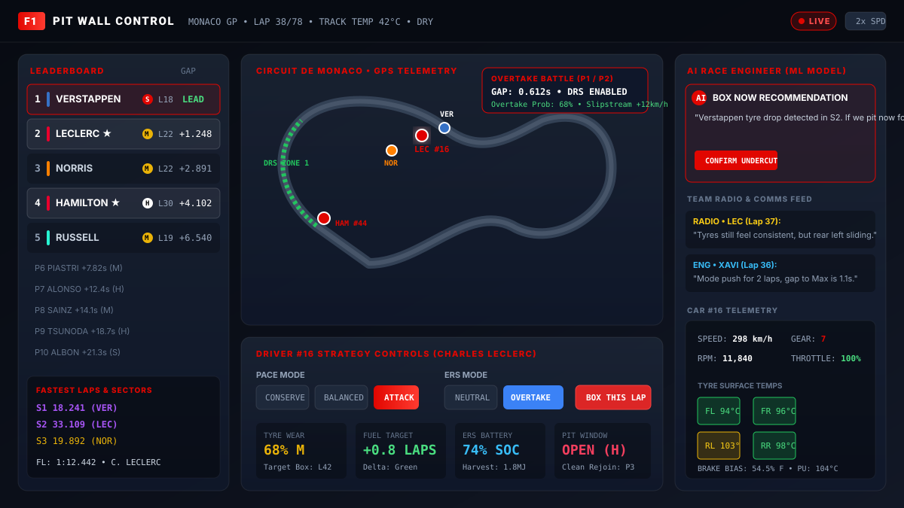
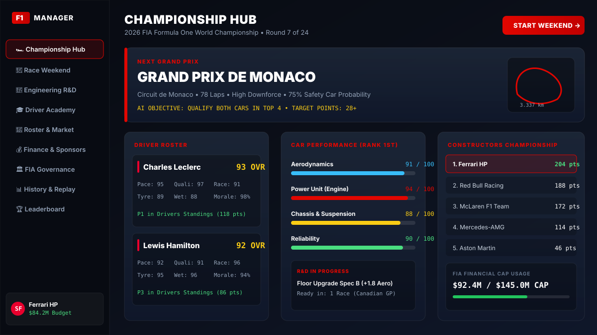
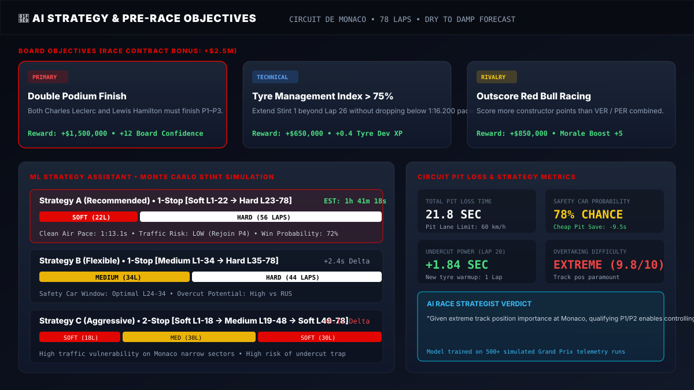
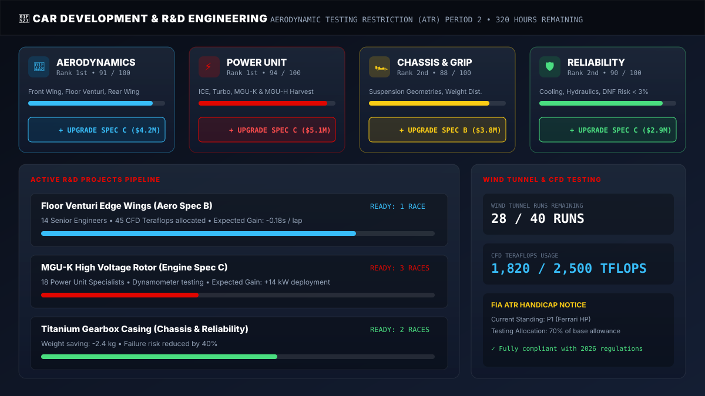
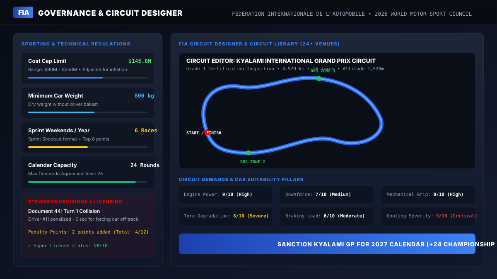

# 🏎️ F1 Principal Simulator: Championship Hub & FIA Suite

[](https://f1principalsim.vercel.app)
[](https://vercel.com/new/clone?repository-url=https%3A%2F%2Fgithub.com%2FThatblazerguy%2Ff1principalsim&env=VITE_SUPABASE_URL,VITE_SUPABASE_ANON_KEY&envDescription=Supabase%20API%20Credentials&project-name=f1principalsim)
[](https://react.dev/)
[](https://www.typescriptlang.org/)
[](https://vitejs.dev/)
[](https://tailwindcss.com/)
[](https://supabase.com/)
[](./LICENSE)

> **Live Deployment:** [https://f1principalsim.vercel.app](https://f1principalsim.vercel.app)  
> *An authentic Formula 1 team principal and FIA regulatory management simulator. Manage drivers, engineering R&D, real-time pit wall strategies, and World Motor Sport Council governance across an entire 24-race championship.*

---

## 📖 Table of Contents

- [🌐 Live Vercel Deployment](#-live-vercel-deployment)
- [📸 Screenshots Showcase](#-screenshots-showcase)
- [🚀 Key Features](#-key-features)
  - [1. Live Pit Wall Command Center (Race Control)](#1-live-pit-wall-command-center-race-control)
  - [2. AI Race Objectives & ML Strategy Intelligence](#2-ai-race-objectives--ml-strategy-intelligence)
  - [3. Full Championship Race Weekend](#3-full-championship-race-weekend)
  - [4. Car Development & Engineering R&D](#4-car-development--engineering-rd)
  - [5. FIA Governance & Circuit Designer Suite](#5-fia-governance--circuit-designer-suite)
  - [6. Driver Roster, Academy & Transfer Market](#6-driver-roster-academy--transfer-market)
  - [7. Financial Ecosystem & Multi-Tier Sponsors](#7-financial-ecosystem--multi-tier-sponsors)
  - [8. Race Replay & Season Analytics](#8-race-replay--season-analytics)
- [🛠️ Tech Stack](#-tech-stack)
- [📦 Project Architecture](#-project-architecture)
- [🚀 Vercel Deployment Guide](#-vercel-deployment-guide)
- [🏁 Local Setup & Getting Started](#-local-setup--getting-started)
- [📊 Database Schema & Supabase](#-database-schema--supabase)
- [🎨 Design System](#-design-system)
- [🔧 Troubleshooting](#-troubleshooting)
- [📄 License & Credits](#-license--credits)

---

## 🌐 Live Vercel Deployment

The application is deployed live on Vercel with automatic CI/CD and production asset optimization:

- **Production URL:** [https://f1principalsim.vercel.app](https://f1principalsim.vercel.app)
- **Deployment Platform:** Vercel (Edge Network + Global CDN)
- **SPA Routing:** Configured with zero-config `vercel.json` URL rewrites
- **Environment Fallback:** Resilient startup logic handles missing or unconfigured Supabase variables without crashing

[](https://vercel.com/new/clone?repository-url=https%3A%2F%2Fgithub.com%2FThatblazerguy%2Ff1principalsim&env=VITE_SUPABASE_URL,VITE_SUPABASE_ANON_KEY&envDescription=Supabase%20API%20Credentials&project-name=f1principalsim)

---

## 📸 Screenshots Showcase

### 1. Live Pit Wall Command Center (Race Control)
*Real-time GPS track telemetry, broadcast-style timing tower, 4-wheel tire thermals, AI race engineer comms, and player strategic orders.*



---

### 2. Championship Hub & Team Overview
*24-race season calendar, driver lineup cards with ratings & morale, constructor standings, and FIA budget cap tracking.*



---

### 3. AI Race Objectives & ML Strategy Suite
*Dynamic board contract objectives, Monte Carlo stint comparison (Soft/Med/Hard), undercut/overcut predictions, and circuit pit loss analytics.*



---

### 4. Car Development & Engineering R&D
*Aerodynamic, Power Unit, Chassis, and Reliability upgrade trees, active project pipelines, and FIA ATR Wind Tunnel/CFD allowances.*



---

### 5. FIA Governance & Circuit Designer
*World Motor Sport Council regulatory management, Cost Cap & Sporting rules, custom Circuit Designer, and 24+ circuit library.*



---

## 🚀 Key Features

### 1. Live Pit Wall Command Center (Race Control)
- **Vector GPS Circuit Positioning (`TrackMap.tsx`):** Real track geometry mapped with corner numbers, DRS zones, and live car coordinates.
- **Broadcast F1 Timing Tower (`TimingTower.tsx`):** Live intervals, gap to leader, tire compound (Soft/Med/Hard/Inter/Wet), tire age in laps, and pit stop counts.
- **Player Tactical Controls (`PlayerStrategyPanel.tsx`):**
  - **Pace Modes:** *Conserve* (protect tires/fuel), *Balanced*, *Push*, and *Attack* (high wear/speed).
  - **Fuel Management:** *Lean* (save fuel), *Standard*, and *Rich* (maximum horsepower).
  - **ERS Battery Deployment:** *Charge* (regenerate battery), *Neutral*, *Deploy*, and *Overtake* boost.
  - **Pit Commands:** Immediate *Box This Lap* order with compound selection.
- **Live Telemetry Matrix (`TelemetryCenter.tsx`):** Real-time monitoring of speed, gear, RPM, throttle percentage, brake bias (54-58% F), PU water temperature, and individual 4-tire surface temperatures (FL, FR, RL, RR).
- **Head-to-Head Battle Tracker (`BattleTracker.tsx`):** Displays real-time DRS detection gaps, slipstream speed deltas, and overtake probabilities.
- **Team Radio & Event Feed (`CommsPanel.tsx`, `LiveEventFeed.tsx`):** Instant radio transmissions between driver and race engineer, sector flags, fastest lap alerts, and safety car notifications.

---

### 2. AI Race Objectives & ML Strategy Intelligence
- **AI-Powered Pre-Race Objectives (`ObjectiveCards.tsx`, `PreRaceBriefingModal.tsx`):**
  - High-stakes board targets (e.g., *Double Podium Finish*, *Tyre Management Index > 75%*, *Outscore Rival Constructor*).
  - Financial prize bonuses ($500K–$2.5M) and board confidence modifiers upon completion.
- **ML Strategy Assistant (`RaceEngineerPanel.tsx`, `MLStrategyEngine.js`):**
  - In-browser machine learning recommendation engine powered by `strategy_ml/model.json`.
  - Calculates real-time **Undercut** and **Overcut** probability matrices based on rival pit windows and tire cliff degradation.
  - Monte Carlo stint duration simulations comparing 1-stop vs 2-stop strategies with pit lane loss deltas.

---

### 3. Full Championship Race Weekend
- **Free Practice Sessions (`game/practice.js`):** Run setup test runs to dial in aerodynamic balance, tire wear rates, and mechanical grip.
- **Knockout Qualifying (`game/qualifying.js`):** Authentic 3-session shootout (Q1 → Q2 → Q3) where the 5 slowest drivers are eliminated each round.
- **Dynamic Grand Prix Simulation (`game/race.js`, `game/raceSimulator.js`):**
  - Dynamic weather transitions (Dry → Drizzle → Heavy Rain).
  - Safety Car (SC) and Virtual Safety Car (VSC) periods creating tactical pit windows.
  - Mechanical reliability failures (ERS faults, hydraulics, engine blowouts).
- **Post-Race Debrief & Detailed Report (`components/ui/DetailedRaceReport.tsx`):** Full 20-driver classification, championship point awards (25-18-15-12-10-8-6-4-2-1 + fastest lap point), penalty notices, and financial earnings breakdown.

---

### 4. Car Development & Engineering R&D
- **4 Core Performance Systems (`screens/engineering.tsx`, `game/development.js`):**
  - **Aerodynamics:** Downforce generation, drag reduction, and high-speed cornering speed.
  - **Power Unit (Engine):** Acceleration, top-end velocity, and ERS electrical harvesting efficiency.
  - **Chassis & Suspension:** Low-speed mechanical grip, curb riding, and weight transfer stability.
  - **Reliability:** Component longevity, cooling efficiency, and reduced DNF probability.
- **R&D Project Pipelines (`data/devProjects.js`):** Commission Spec B / Spec C major updates, assign specialized engineering staff, and track race delivery lead times.
- **FIA Aerodynamic Testing Restrictions (ATR):** Sliding scale handicap rules allocating more Wind Tunnel runs and CFD Teraflops to struggling teams.
- **Circuit Demands Suitability Matrix (`utils/circuitSuitability.js`):** Evaluates car performance against 7 circuit demands (*Power, Aero, Mechanical Grip, Tyre Degradation, Braking Load, Cooling, Wet Weather*).

---

### 5. FIA Governance & Circuit Designer Suite
- **World Motor Sport Council Dashboard (`fia/FIADashboard.tsx`):** Step into the shoes of the FIA governing body to steer the future of Formula 1.
- **Sporting & Technical Regulations Editor (`fia/screens/FIARegulations.tsx`):**
  - Adjust the **Cost Cap** ($80M to $250M limit).
  - Set **Minimum Car Weight** (750kg to 900kg).
  - Regulate Sprint Weekend allocations (0 to 12 sprints per season).
  - Customize championship points distribution tables and fastest lap bonuses.
- **Interactive Circuit Designer (`fia/screens/FIACircuitDesigner.tsx`):**
  - Design custom circuits with sector geometry, corner radiuses, and straight lengths.
  - Place DRS detection points and activation zones.
  - Run FIA Grade 1 safety inspections and evaluate suitability scores.
- **Circuit Library (`fia/circuitLibrary.js`, `fia/screens/FIACircuitLibrary.tsx`):** 24+ global circuits with comprehensive performance-demand ratings, contract durations, and historical records.
- **Stewards Office & Super Licensing (`fia/screens/FIADecisions.tsx`, `fia/screens/FIALicensing.tsx`):** Issue official document penalties (time penalties, grid drops, license penalty points) and monitor super license eligibility.

---

### 6. Driver Roster, Academy & Transfer Market
- **10 In-Depth Driver Attributes (0–100 scale):** Pace, Qualifying, Racecraft, Tyre Management, Wet Weather, Consistency, Adaptability, Feedback, Mentality, and Media Handling.
- **Hidden Traits & Personalities:** Pressure resistance, work ethic, and team leader dynamics.
- **Driver Academy (`screens/academy.tsx`, `game/academy.js`):**
  - Scout junior prospects across Europe, Americas, Asia-Pacific, Middle East, and Africa.
  - Set customized training programs to nurture rookie talent.
  - Promote standout academy drivers directly into reserve or full race seats.
- **Driver Transfer Market (`screens/market.tsx`, `screens/myDrivers.tsx`):** Negotiate multi-year contracts, set release clauses, manage driver morale, and scout competitor talent.

---

### 7. Financial Ecosystem & Multi-Tier Sponsors
- **FIA Cost Cap Financial Tracker (`screens/finance.tsx`):** Track seasonal operational expenditures against the strict cost cap ceiling.
- **Sponsorship Contracts (`data/sponsors.js`, `screens/sponsors.tsx`):**
  - **Title Sponsors:** High-value annual funding with championship position clauses.
  - **Technical Partners:** Provide car component discounts and R&D speed bonuses.
  - **Media Partners:** Weekly recurring revenue tied to PR and social engagement.
- **Prize Money Distribution:** End-of-season payouts calculated dynamically from constructors standings.

---

### 8. Race Replay & Season Analytics
- **Lap-by-Lap GPS Race Replay (`screens/RaceReplay.tsx`):** Scrub through completed races with interactive timeline playback, track-map positioning, and tire wear indicators.
- **Historical Season Vault (`screens/history.tsx`):** Complete archive of past Grand Prix results, podium finishes, driver form charts, and constructor head-to-head records.
- **Live Leaderboards (`screens/leaderboard.tsx`):** Dynamic Drivers and Constructors World Championship points tables with graphical gap visualizers.

---

## 🛠️ Tech Stack

| Layer | Technologies |
|---|---|
| **Frontend Framework** | [React 19](https://react.dev/) + TypeScript |
| **Build & Tooling** | [Vite 6.0](https://vitejs.dev/) (Hot Module Replacement, Rollup Bundling) |
| **Styling & Design** | [Tailwind CSS v4](https://tailwindcss.com/) + PostCSS + Custom F1 Glassmorphism CSS |
| **UI Components** | [Radix UI](https://www.radix-ui.com/) Primitives, [Lucide React](https://lucide.dev/) Icons |
| **Animations** | [Framer Motion 12](https://www.framer.com/motion/) |
| **Charts & Visuals** | [Chart.js 4](https://www.chartjs.org/) + `react-chartjs-2` |
| **Backend & Auth** | [Supabase](https://supabase.com/) (PostgreSQL, Row Level Security, Supabase Auth) |
| **F1 Telemetry & Data**| [OpenF1 API](https://openf1.org/) integration for real-time driver/team data |
| **Strategy Intelligence**| In-Browser Monte Carlo Simulation + Exported Strategy Models (`strategy_ml/`) |
| **Deployment** | [Vercel](https://vercel.com/) (Edge Network, Static SPA Hosting) |

---

## 📦 Project Architecture

```
f1manager/
├── assets/                          # Static brand assets & typography
│   ├── fonts/                       # Official Formula 1 typeface family
│   └── screenshots/                 # High-resolution screenshot graphics
│       ├── pitwall-dashboard.svg    # Live pit wall command center
│       ├── championship-hub.svg     # Championship hub dashboard
│       ├── ai-strategy-engineer.svg # AI race objectives & ML strategy
│       ├── engineering-rd.svg       # Car development & R&D projects
│       └── fia-governance.svg       # FIA governance & circuit designer
├── components/                      # Reusable UI & HUD components
│   ├── HubLayout.tsx                # Championship hub navigation shell
│   ├── NavDropdown.tsx              # Navigation menu popovers
│   ├── driverComparison.tsx         # Driver attribute comparison radar
│   └── ui/                          # Radix primitives & Pit Wall HUD
│       ├── BattleTracker.tsx        # Real-time DRS & overtake battles
│       ├── CommsPanel.tsx           # Team radio & engineer chatter
│       ├── DetailedRaceReport.tsx   # Grand Prix post-race classification
│       ├── LiveEventFeed.tsx        # Race events, flags & pit stops
│       ├── ObjectiveCards.tsx       # AI pre-race objective cards
│       ├── PlayerStrategyPanel.tsx  # Push mode, fuel, ERS & box commands
│       ├── PreRaceBriefingModal.tsx # Pre-race strategy briefing dialog
│       ├── RaceEngineerPanel.tsx    # AI ML race engineer recommendations
│       ├── StrategyIntelligenceCard.tsx # Pit delta & undercut calculators
│       ├── TelemetryCenter.tsx      # 4-wheel tire temps & speed gauges
│       ├── TimingTower.tsx          # F1-style live timing & intervals
│       └── TrackMap.tsx             # Vector GPS circuit tracking
├── data/                            # Game datasets & real-world records
│   ├── calendar.js                  # 24-race 2026 championship calendar
│   ├── drivers.js                   # OpenF1 synced driver roster
│   ├── realTrackLayouts.js          # GPS circuit coordinates & DRS zones
│   ├── sponsors.js                  # Multi-tier sponsorship contracts
│   ├── strategyProfiles.js          # Circuit tire degradation profiles
│   └── teams.js                     # 10 Official F1 constructor records
├── fia/                             # FIA Regulatory & Governance Suite
│   ├── FIADashboard.tsx             # FIA World Council command center
│   ├── circuitDesigner.js           # Circuit geometry & turn calculation
│   ├── circuitLibrary.js            # 24+ circuit database with demand metrics
│   ├── fiaState.js                  # FIA regulatory state management
│   └── screens/                     # FIA governance sub-screens
│       ├── FIACalendarBoard.tsx     # Calendar sanctioning & scheduling
│       ├── FIACircuitDesigner.tsx   # Custom circuit designer interface
│       ├── FIACircuitLibrary.tsx    # Circuit database & suitability analysis
│       ├── FIADecisions.tsx         # Stewards hearings & penalty logs
│       ├── FIALicensing.tsx         # Super license & penalty points
│       ├── FIARegulations.tsx       # Cost cap & sporting rules editor
│       └── FIASeasonReview.tsx      # Season ratification & review
├── game/                            # Core simulation engines
│   ├── LiveRaceEngine.js            # Lap-by-lap interactive race simulation
│   ├── MLStrategyEngine.js          # Strategy assistant model runner
│   ├── academy.js                   # Driver academy training mechanics
│   ├── development.js               # Car performance upgrade logic
│   ├── qualifying.js                # Q1/Q2/Q3 knockout session logic
│   ├── race.js                      # Single race simulation engine
│   └── raceHistory.js               # Historical season stats accumulator
├── lib/                             # External clients & API helpers
│   ├── supabaseClient.js            # Supabase initialization with fallback
│   ├── supabaseApi.js               # Cloud database CRUD operations
│   └── utils.ts                     # UI utility functions
├── screens/                         # Full-page application screens
│   ├── ChampionshipHub.tsx          # Main championship dashboard
│   ├── RaceControl.tsx              # Live pit wall race center
│   ├── RaceReplay.tsx               # Historical race GPS scrubber
│   ├── academy.tsx                  # Driver academy & prospect scouting
│   ├── auth.tsx                     # Supabase authentication portal
│   ├── engineering.tsx              # Car R&D and upgrade center
│   ├── finance.tsx                  # Budget & cost cap tracker
│   ├── history.tsx                  # Grand Prix history & driver form
│   ├── landing.tsx                  # Animated splash/landing page
│   ├── leaderboard.tsx              # Championship standings tables
│   ├── market.tsx                   # Driver transfer market
│   ├── myDrivers.tsx                # Team driver roster management
│   ├── setup.tsx                    # New season team & driver setup
│   ├── sponsors.tsx                 # Sponsorship contract management
│   └── weekend.tsx                  # Practice → Qualifying → Race flow
├── strategy_ml/                     # Machine learning models & training
│   ├── model.json                   # Exported ML rules for in-browser inference
│   └── train_model.py               # Python model training script
├── utils/                           # Helper utilities
│   ├── circuitSuitability.js        # 7-pillar circuit performance modifier
│   ├── classificationValidator.js   # Race classification consistency checks
│   └── reactRoot.tsx                # Dynamic React mount helper
├── vercel.json                      # Vercel SPA routing rewrite rules
├── supabase_schema.sql              # Supabase table definitions & RLS
├── f1_save_patch.sql                # Database migration patches
├── vite.config.js                   # Vite configuration
└── package.json                     # Project manifest & dependencies
```

---

## 🚀 Vercel Deployment Guide

Deploying F1 Principal Simulator to Vercel takes less than two minutes:

### Option A: One-Click Deploy Button
Click the button below to fork and deploy directly with pre-configured project settings:

[](https://vercel.com/new/clone?repository-url=https%3A%2F%2Fgithub.com%2FThatblazerguy%2Ff1principalsim&env=VITE_SUPABASE_URL,VITE_SUPABASE_ANON_KEY&envDescription=Supabase%20API%20Credentials&project-name=f1principalsim)

---

### Option B: Deploying via Vercel Web Dashboard

1. **Sign In:** Log in to [Vercel](https://vercel.com/).
2. **Add New Project:** Click **Add New...** → **Project**.
3. **Import Git Repository:** Select `f1principalsim` (or your forked repository).
4. **Configure Project Settings:**
   - **Framework Preset:** `Vite`
   - **Root Directory:** `./`
   - **Build Command:** `npm run build`
   - **Output Directory:** `dist`
   - **Install Command:** `npm install`
5. **Set Environment Variables:**
   Expand the **Environment Variables** section and add:

   | Variable | Required | Description | Example |
   |---|---|---|---|
   | `VITE_SUPABASE_URL` | Optional | Your Supabase project URL | `https://your-ref.supabase.co` |
   | `VITE_SUPABASE_ANON_KEY` | Optional | Your Supabase public anon key | `eyJhbGciOi...` |
   | `VITE_OPENF1_API_URL` | Optional | OpenF1 API endpoint | `https://api.openf1.org` |

   > **Note on Supabase:** If you don't provide Supabase credentials, the app **automatically operates in Demo/Local Mode** using localStorage, ensuring seamless exploration with zero crashes!

6. **Deploy:** Click **Deploy**. Vercel will build and assign your live URL (e.g., `https://f1principalsim.vercel.app`).

---

### Option C: Deploying via Vercel CLI

```bash
# 1. Install the Vercel CLI globally
npm install -g vercel

# 2. Log in to your Vercel account
vercel login

# 3. Link and deploy preview build
vercel

# 4. Deploy directly to production
vercel --prod
```

### SPA Routing (`vercel.json`)
This repository includes a pre-configured `vercel.json` file ensuring all client-side navigation paths resolve to `index.html`:
```json
{
  "rewrites": [
    { "source": "/(.*)", "destination": "/index.html" }
  ]
}
```

---

## 🏁 Local Setup & Getting Started

### Prerequisites
- **Node.js:** v18.0.0 or higher ([Download Node.js](https://nodejs.org/))
- **npm** or **yarn**
- **Git**

### Installation

```bash
# 1. Clone the repository
git clone https://github.com/Thatblazerguy/f1principalsim.git
cd f1principalsim

# 2. Install dependencies
npm install

# 3. Create .env file (optional)
cp .env.example .env 2>/dev/null || cat << 'EOF' > .env
VITE_SUPABASE_URL=https://your-project.supabase.co
VITE_SUPABASE_ANON_KEY=your_anon_key_here
VITE_OPENF1_API_URL=https://api.openf1.org
EOF

# 4. Launch development server with HMR
npm run dev

# 5. Build for production
npm run build
```

The development server runs at `http://localhost:5173`.

---

## 📊 Database Schema & Supabase

When running with Supabase enabled, user save states and championship records are persisted with **Row Level Security (RLS)**:

- `profiles` – User display names and avatar references (linked to `auth.users`).
- `user_game_state` – Selected constructor, driver IDs, championship points, budget balance, and upgrade levels.
- `race_results` – Full classification records, finishing positions, and points earned per Grand Prix.
- `teams` & `drivers` – Global reference data synchronized with the OpenF1 API.

To initialize your own Supabase project:
1. Open your Supabase Dashboard → **SQL Editor**.
2. Run `supabase_schema.sql` to generate tables and RLS security policies.
3. Run `f1_save_patch.sql` for incremental schema updates.

---

## 🎨 Design System

The simulator incorporates an authentic Formula 1 broadcast design system:
- **Color Palette:**
  - Background: Deep Navy Obsidian (`#080B12`, `#0B0F19`)
  - F1 Brand Racing Red: `#E10600`
  - Telemetry Accents: Electric Cyan (`#38BDF8`), Emerald Green (`#4ADE80`), Amber (`#FACC15`)
- **Typography:** Custom Formula 1 typeface family (`Formula1-Wide`, `Formula1-Bold`, `Formula1-Regular`).
- **Glassmorphism:** 12px backdrop blur cards with subtle translucent white borders (`rgba(255,255,255,0.08)`).

---

## 🔧 Troubleshooting

| Issue | Cause | Solution |
|---|---|---|
| **App loads but displays demo mode warning** | Supabase credentials missing | Normal behavior. Provide `VITE_SUPABASE_URL` and `VITE_SUPABASE_ANON_KEY` in `.env` or Vercel environment variables to enable cloud saving. |
| **Vercel 404 on refresh** | Missing rewrite rules | Ensure `vercel.json` exists in project root with `{"rewrites": [{"source": "/(.*)", "destination": "/index.html"}]}`. |
| **Styling issues after build** | Tailwind purge mismatch | Run `npm run build` locally to verify `@tailwindcss/postcss` compilation. |
| **Live Race simulation lags** | Heavy background tasks | Close dev tools console logging; simulation runs at optimal 60 FPS requestAnimationFrame. |

---

## 📄 License & Credits

- **License:** Licensed under the [ISC License](./LICENSE).
- **Formula 1 Branding & Data:** Inspired by Formula 1. Real-world driver and circuit metadata powered by the [OpenF1 API](https://openf1.org/).
- **Created by:** [Thatblazerguy](https://github.com/Thatblazerguy)

---

*Ready to lead your team to World Championship glory? Take the pit wall at [f1principalsim.vercel.app](https://f1principalsim.vercel.app)! 🏁*
