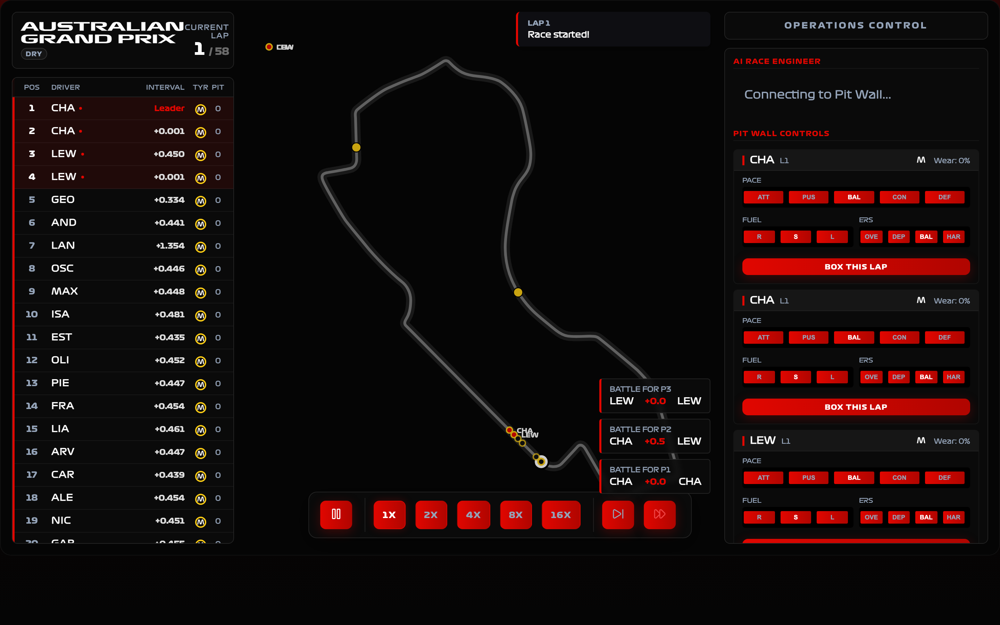
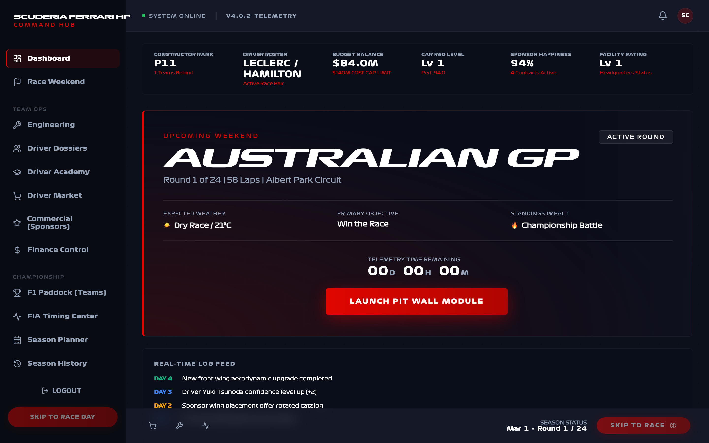
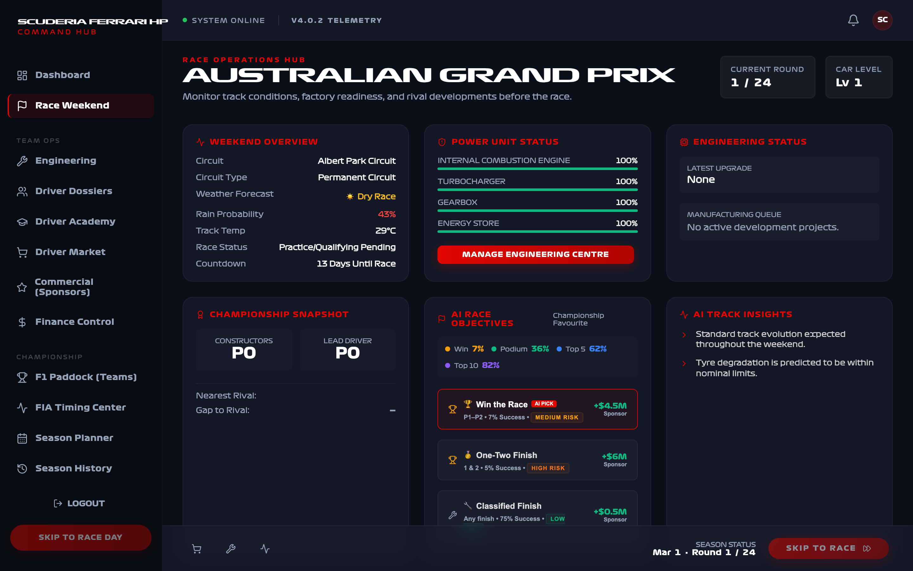
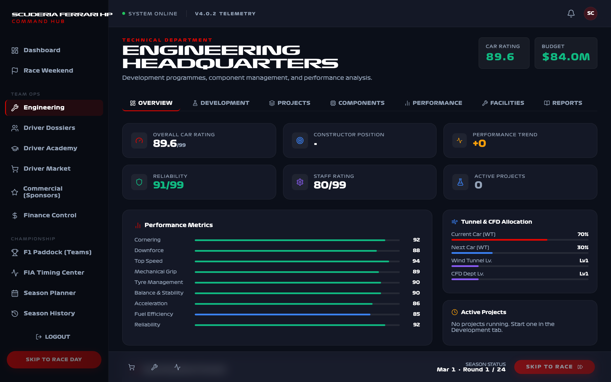
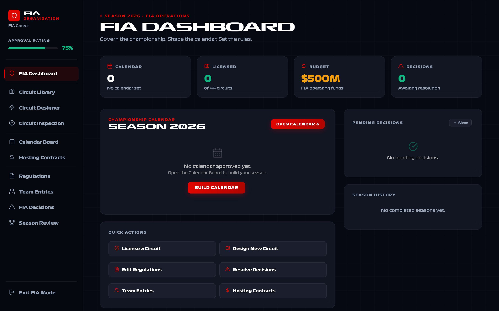
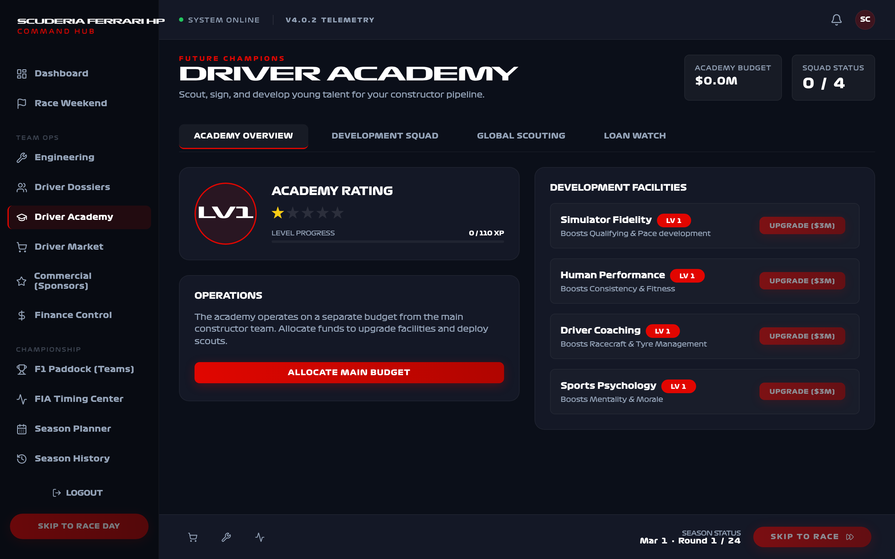

# F1P: Championship Hub & FIA Suite

[](https://f1principalsim.vercel.app)
[](https://f1principalsim-orpin.vercel.app/)
[](https://vercel.com/new/clone?repository-url=https%3A%2F%2Fgithub.com%2FThatblazerguy%2Ff1principalsim&env=VITE_SUPABASE_URL,VITE_SUPABASE_ANON_KEY&envDescription=Supabase%20API%20Credentials&project-name=f1principalsim)
[](https://react.dev/)
[](https://www.typescriptlang.org/)
[](https://vitejs.dev/)
[](https://tailwindcss.com/)
[](https://supabase.com/)
[](./LICENSE)

> **Live Deployment:** [https://f1principalsim.vercel.app](https://f1principalsim.vercel.app)  
> **Live Deployment:** [https://f1principalsim-orpin.vercel.app/](https://f1principalsim-orpin.vercel.app/)  
> *A motorsport team principal and FIA regulatory management game. Manage drivers, engineering R&D, real-time pit wall strategies, and World Motor Sport Council governance across an entire 24-race championship.*

---

## 📖 Table of Contents

- [🌐 Live Vercel Deployment](#-live-vercel-deployment)
- [📸 Screenshots Showcase](#-screenshots-showcase)
- [🚀 Key Features](#-key-features)
  - [1. Live Pit Wall Command Center (Race Control)](#1-live-pit-wall-command-center-race-control)
  - [2. ML Pit Strategy, AI Race Engineer & Setup Neural Network](#2-ml-pit-strategy-ai-race-engineer--setup-neural-network)
  - [3. Full Championship Race Weekend](#3-full-championship-race-weekend)
  - [4. Car Development & Engineering R&D](#4-car-development--engineering-rd)
  - [5. FIA Governance & Circuit Designer Suite](#5-fia-governance--circuit-designer-suite)
  - [6. Driver Roster, Academy & Transfer Market](#6-driver-roster-academy--transfer-market)
  - [7. Financial Ecosystem & Multi-Tier Sponsors](#7-financial-ecosystem--multi-tier-sponsors)
  - [8. Race Replay & Season Analytics](#8-race-replay--season-analytics)
- [🛠️ Tech Stack](#-tech-stack)
- [📦 Project Architecture](#-project-architecture)
- [🚀 Vercel Deployment Guide](#-vercel-deployment-guide)
- [🏁 Local Setup & Getting Started](#-local-setup--getting-started)
- [📊 Database Schema & Supabase](#-database-schema--supabase)
- [🎨 Design System](#-design-system)
- [🔧 Troubleshooting](#-troubleshooting)
- [📄 License & Credits](#-license--credits)

---

## 🌐 Live Vercel Deployment

The application is deployed live on Vercel with automatic CI/CD and production asset optimization:

- **Production URL:** [https://f1principalsim.vercel.app](https://f1principalsim.vercel.app)
- **Production URL:** [https://f1principalsim-orpin.vercel.app/](https://f1principalsim-orpin.vercel.app/)
- **Deployment Platform:** Vercel (Edge Network + Global CDN)
- **SPA Routing:** Configured with zero-config `vercel.json` URL rewrites
- **Environment Fallback:** Resilient startup logic handles missing or unconfigured Supabase variables without crashing

[](https://vercel.com/new/clone?repository-url=https%3A%2F%2Fgithub.com%2FThatblazerguy%2Ff1principalsim&env=VITE_SUPABASE_URL,VITE_SUPABASE_ANON_KEY&envDescription=Supabase%20API%20Credentials&project-name=f1principalsim)

---

## 📸 Screenshots Showcase

### 1. Live Pit Wall Command Center (Race Control)
*Live circuit map with every car, broadcast-style timing tower, battles, race feed, AI race engineer and driver orders.*



---

### 2. Championship Hub & Team Overview
*24-race season calendar, driver lineup cards with ratings & morale, constructor standings, and FIA budget cap tracking.*



---

### 3. Race Weekend (Practice, Qualifying & Strategy Briefing)
*Full weekend workflow: setup fine-tuning, 3-tier knockout qualifying shootout, and pre-race tactical objectives.*



---

### 4. Car Development & Engineering R&D
*Aerodynamic, Power Unit, Chassis, and Reliability upgrade trees, active project development pipelines, and FIA ATR Wind Tunnel/CFD allocations.*



---

### 5. FIA Governance & Circuit Designer
*World Motor Sport Council regulatory management, Cost Cap & Sporting rules, custom Circuit Designer, and 24+ circuit library.*



---

### 6. Driver Academy & Junior Development
*Scout young prospects across 5 continental regions, assign specialized training regimens, and promote talent to race seats.*



---

### 7. Landing & Career Selection Portal
*Atmospheric entrance portal with telemetry styling, career progression selection, and telemetry gateway.*


---

## 🚀 Key Features

### 1. Live Pit Wall Command Center (Race Control)
Everything on this screen reads the live race engine (`game/LiveRaceEngine.js`); player commands go through the engine's own pit, pace, fuel and ERS calls.
- **Live circuit map (`components/race/LiveCircuit.tsx`):** The real layout with every car in team colours, start line, sector markers, the DRS straight, corner numbers and a pit lane. Markers ease toward each car's engine position every frame. Hover for position, speed and tyres; click for telemetry; zoom, pan or focus a sector.
- **Timing tower (`components/race/RaceParts.tsx`):** Interval or gap to leader, tyre compound and age, stops, places gained or lost, pit and retirement status. Filters for our drivers, constructor and pit status; rows animate and flash on position changes.
- **Pit wall (`components/race/PitWall.tsx`):**
  - **Race tab:** position against the projected finish and target, gaps ahead and behind with trend, tyre wear, fuel margin, ERS battery and engine temperature.
  - **Driver instructions:** pace (*Attack*, *Push*, *Balanced*, *Conserve*, *Defend*), fuel mix (*Rich*, *Standard*, *Lean*) and ERS (*Overtake*, *Deploy*, *Balanced*, *Harvest*), each showing its effect. The AI race engineer's calls and auto mode are here too.
  - **Pit strategy tab:** stint timeline, predicted tyre life and degradation, pit window, recommended compound, pit-lane time loss and rejoin estimate. *Box this lap* with compound choice, *Stay out*, or a stop planned for a later lap; the strategy model's ranking of options.
  - **Radio tab:** driver and engineer messages.
- **Battles (`components/race/BattleBoard.tsx`):** Cars within a second, our drivers first, with gap trend, DRS range, tyre age difference and relative pace.
- **Race feed:** Lights out, overtakes, pit stops, fastest laps, retirements and the chequered flag, with lap and race time, in a filterable log.
- **Telemetry (`components/race/TelemetryPanel.tsx`):** Average speed, last and best lap, tyres, fuel, ERS, gaps to leader and teammate, and per-lap charts compared with the teammate.
- **Playback:** Pause, 1× to 16× speed, next event, next lap and skip to the flag. Space pauses; keys 1 to 5 set the speed.
- **Broadcast mode:** A larger map and timing tower without the pit wall, with banners for overtakes, fastest laps and retirements.

---

### 2. ML Pit Strategy, AI Race Engineer & Setup Neural Network
- **ML pit-strategy model (`game/strategy/`, `scripts/train-strategy-model.mjs`):**
  - Predicts our expected finishing position for each pit option (box now, in 2/4/7/11 laps, or no stop) from the live race state, in ~55 µs per decision.
  - **Teacher:** a seeded Monte Carlo rollout simulator built on the shared pace model, with traffic, dirty air, overtaking rolls and rivals' own pit stops. A rollout-based decision takes ~113 ms, too slow to run live for every option, so the network learns to imitate it.
  - **Architecture:** a value ensemble (race state → places gained or lost) plus an advantage ensemble (state + option → how much better or worse this option is). Both are 3-member MLPs written from scratch in plain JS. The advantage net also gets the time-only planner's cost for each option, so it learns a *correction* on top of the physics (traffic, undercuts) rather than relearning tyre maths. The ensemble spread is shown in-game as uncertainty.
  - **Data:** 6,000 race states (32k state–option samples) on 19 circuits, labelled with 24 rollouts per option using common random numbers.
  - **Offline evaluation** on 5 held-out circuits (Suzuka, Hungaroring, Singapore, Interlagos, Lusail), against a fresh oracle with 96 rollouts per option. "Regret" is how many positions a pick loses against the best option:

    | Decision rule | Mean regret (positions) |
    |---|---|
    | **Strategy model** | **0.174** |
    | Race engineer's time-only planner | 0.208 |
    | Always box now | 1.446 |
    | Random option | 1.456 |

  - **End-to-end evaluation** (`npm run eval:strategy`): 200 paired races in the real live race engine (with safety cars, VSCs and archetype-based AI strategies) on the held-out circuits, with the engineer on auto and both runs from the same seed. Pit calls from the model finished **0.63 places better per car** than the planner (standard error 0.11, average P12.30 vs P12.93); the model was ahead in 114 races and behind in 56. Under a safety car the engineer takes the cheap stop itself, since the model was trained without neutralisations.
  - In Race Control the pit wall shows the model's ranking of options next to the planner's pick. It flags disagreements worth ≥0.3 places, and on auto it makes the pit calls.
- **Forecast-driven race objectives (`utils/raceForecast.js`, `utils/raceObjectives.js`):**
  - Before each Grand Prix the game simulates the race 300 times. It uses every car's pace profile on this circuit (car rating including your engineering upgrades, driver skill, form, setup quality, circuit fit), the track's rain odds, its overtaking difficulty and tyre wear, per-car reliability, and, once qualifying has run, the real grid and weather.
  - Targets are pitched from those odds: the primary objective is the most ambitious finish you reach at least 40% of the time, plus a stretch goal and a banker. Rival, hold-position (hard-to-pass tracks), gain-places (easier tracks, when starting out of position) and reliability objectives appear only when the forecast says they're in play.
  - Every success percentage is a simulated frequency, and each explanation cites the numbers behind it, e.g. *"On pace we're 4th of 11 teams here, 0.31s a lap off the quickest car. There's a 40% chance of rain… In 300 simulated races one of our cars finished on the podium 46% of the time."*
  - Each objective records how it will be judged after the race (best finish, both cars, beat a team, places gained, held position, both classified).
- **AI Race Engineer (`game/RaceEngineer.js`, shown in `components/race/PitWall.tsx`):**
  - A rule-based pit-wall strategist built on the shared pace model (`game/paceModel.js`), the same model both race engines use.
  - Every tick it computes real gaps and closing rates, laps to the tyre cliff, the best pit plan for the rest of the race (box now / in N laps / stay out) and the rejoin position.
  - Flags undercut/overcut chances and threats from behind, makes pace/ERS/fuel calls, and can run the car on its own.
- **Setup Lab neural network (`game/setup/`, `scripts/train-setup-model.mjs`):**
  - A 3-member MLP ensemble (19→24→16→1), written from scratch in plain JavaScript and trained on 24,000 generated "simulator" samples across real and synthetic circuits (`npm run train:setup`, seeded for reproducibility).
  - Evaluated on 8 held-out real circuits (held-out MAE 0.0245). It cuts setup loss from 0.180 (neutral setup) to 0.094 before practice, and to 0.033 after the practice runs refine it.

---

### 3. Full Championship Race Weekend
- **Free Practice Sessions (`game/practice.js`):** Run setup test runs to dial in aerodynamic balance, tire wear rates, and mechanical grip.
- **Knockout Qualifying (`game/qualifying.js`):** Authentic 3-session shootout (Q1 → Q2 → Q3) where the 5 slowest drivers are eliminated each round.
- **One set of race rules, two engines (`game/raceEvents.js`):** the lap-batched quick sim (`game/raceSimulator.js`) and the live pit wall (`game/LiveRaceEngine.js`) share the same pace model and the same race events, so a Grand Prix plays by the same rules whichever you choose:
  - **Safety cars and VSCs:** the field bunches up, no overtaking, and pit stops cost about half. The AI and the race engineer take the cheap stop.
  - **Season settings:** weather, safety-car frequency, failure rate and AI aggressiveness are all applied. Aggressive AI races harder and makes more mistakes.
  - **Strategy and reliability:** AI strategy is chosen by team archetype; first-lap incidents; one reliability model (tracked component wear for your cars, team reliability for the rest).
  - **Weather:** decided once per weekend. Qualifying's conditions are the race's conditions.
  - **Sporting rules:** two dry compounds in a dry race or disqualification; a retired car that completed 90% of the distance is still classified and scores.
  - **Seeded and reproducible:** every qualifying session and race runs from a stored seed, and the same seed (with the same inputs) replays the same race.
- **Sprint weekends:** on sprint rounds (when sprints are on), a sprint runs from the qualifying grid before the Grand Prix: about a third of the distance, no mandatory stop, points for the top 8 (8-7-6-5-4-3-2-1).
- **Qualifying on the same pace model:** a qualifying lap is the car's race-pace profile on low fuel and fresh softs, plus the driver's one-lap skill, so the car counts once and poles are shared out realistically rather than one team taking almost all of them.
- **Race objectives are a trade-off:** pushing for a win is quicker per lap but wears tyres faster and brings more mistakes and failures; across hundreds of simulated races no objective gives a free advantage.
- **Post-Race Debrief & Detailed Report (`components/ui/DetailedRaceReport.tsx`):** Full classification, championship points, penalty notices, and financial earnings breakdown.

---

### 4. Car Development & Engineering R&D
- **4 Core Performance Systems (`screens/engineering.tsx`, `game/development.js`):**
  - **Aerodynamics:** Downforce generation, drag reduction, and high-speed cornering speed.
  - **Power Unit (Engine):** Acceleration, top-end velocity, and ERS electrical harvesting efficiency.
  - **Chassis & Suspension:** Low-speed mechanical grip, curb riding, and weight transfer stability.
  - **Reliability:** Component longevity, cooling efficiency, and reduced DNF probability.
- **R&D Project Pipelines (`data/devProjects.js`):** Commission Spec B / Spec C major updates, assign specialized engineering staff, and track race delivery lead times.
- **FIA Aerodynamic Testing Restrictions (ATR):** Sliding scale handicap rules allocating more Wind Tunnel runs and CFD Teraflops to struggling teams.
- **Circuit Demands Suitability Matrix (`utils/circuitSuitability.js`):** Evaluates car performance against 7 circuit demands (*Power, Aero, Mechanical Grip, Tyre Degradation, Braking Load, Cooling, Wet Weather*).

---

### 5. FIA Governance & Circuit Designer Suite
- **World Motor Sport Council Dashboard (`fia/FIADashboard.tsx`):** Step into the shoes of the FIA governing body to steer the future of the championship.
- **Sporting & Technical Regulations Editor (`fia/screens/FIARegulations.tsx`):**
  - Adjust the **Cost Cap** ($80M to $250M limit).
  - Set **Minimum Car Weight** (750kg to 900kg).
  - Regulate Sprint Weekend allocations (0 to 12 sprints per season).
  - Customize championship points distribution tables and fastest lap bonuses.
- **Interactive Circuit Designer (`fia/screens/FIACircuitDesigner.tsx`):**
  - Design custom circuits with sector geometry, corner radiuses, and straight lengths.
  - Place DRS detection points and activation zones.
  - Run FIA Grade 1 safety inspections and evaluate suitability scores.
- **Circuit Library (`fia/circuitLibrary.js`, `fia/screens/FIACircuitLibrary.tsx`):** 24+ global circuits with comprehensive performance-demand ratings, contract durations, and historical records.
- **Stewards Office & Super Licensing (`fia/screens/FIADecisions.tsx`, `fia/screens/FIALicensing.tsx`):** Issue official document penalties (time penalties, grid drops, license penalty points) and monitor super license eligibility.

---

### 6. Driver Roster, Academy & Transfer Market
- **10 In-Depth Driver Attributes (0–100 scale):** Pace, Qualifying, Racecraft, Tyre Management, Wet Weather, Consistency, Adaptability, Feedback, Mentality, and Media Handling.
- **Hidden Traits & Personalities:** Pressure resistance, work ethic, and team leader dynamics.
- **Driver Academy (`screens/academy.tsx`, `game/academy.js`):**
  - Scout junior prospects across Europe, Americas, Asia-Pacific, Middle East, and Africa.
  - Set customized training programs to nurture rookie talent.
  - Promote standout academy drivers directly into reserve or full race seats.
- **Driver Transfer Market (`screens/market.tsx`, `screens/myDrivers.tsx`):** Negotiate multi-year contracts, set release clauses, manage driver morale, and scout competitor talent.

---

### 7. Financial Ecosystem & Multi-Tier Sponsors
- **FIA Cost Cap Financial Tracker (`screens/finance.tsx`):** Track seasonal operational expenditures against the strict cost cap ceiling.
- **Sponsorship Contracts (`data/sponsors.js`, `screens/sponsors.tsx`):**
  - **Title Sponsors:** High-value annual funding with championship position clauses.
  - **Technical Partners:** Provide car component discounts and R&D speed bonuses.
  - **Media Partners:** Weekly recurring revenue tied to PR and social engagement.
- **Prize Money Distribution:** End-of-season payouts calculated dynamically from constructors standings.

---

### 8. Race Replay & Season Analytics
- **Lap-by-Lap GPS Race Replay (`screens/RaceReplay.tsx`):** Scrub through completed races with interactive timeline playback, track-map positioning, and tire wear indicators.
- **Historical Season Vault (`screens/history.tsx`):** Complete archive of past Grand Prix results, podium finishes, driver form charts, and constructor head-to-head records.
- **Live Leaderboards (`screens/leaderboard.tsx`):** Dynamic Drivers and Constructors World Championship points tables with graphical gap visualizers.

---

## 🛠️ Tech Stack

| Layer | Technologies |
|---|---|
| **Frontend Framework** | [React 19](https://react.dev/) + TypeScript |
| **Build & Tooling** | [Vite 6.0](https://vitejs.dev/) (Hot Module Replacement, Rollup Bundling) |
| **Styling & Design** | [Tailwind CSS v4](https://tailwindcss.com/) + PostCSS + Custom F1 Glassmorphism CSS |
| **UI Components** | [Radix UI](https://www.radix-ui.com/) Primitives, [Lucide React](https://lucide.dev/) Icons |
| **Animations** | [Framer Motion 12](https://www.framer.com/motion/) |
| **Charts & Visuals** | [Chart.js 4](https://www.chartjs.org/) + `react-chartjs-2` |
| **Backend & Auth** | [Supabase](https://supabase.com/) (PostgreSQL, Row Level Security, Supabase Auth) |
| **F1 Telemetry & Data**| [OpenF1 API](https://openf1.org/) integration for real-time driver/team data |
| **Strategy & ML** | Neural pit-strategy model distilled from Monte Carlo rollouts; AI race engineer on a shared pace model; from-scratch MLP ensemble for car setup |
| **Deployment** | [Vercel](https://vercel.com/) (Edge Network, Static SPA Hosting) |

---

## 📦 Project Architecture

```
f1manager/
├── assets/                          # Static brand assets & typography
│   ├── fonts/                       # Display typeface family
│   └── screenshots/                 # High-resolution screenshots captured from the app
│       ├── pitwall-dashboard.png    # Live pit wall command center
│       ├── championship-hub.png     # Championship hub dashboard
│       ├── race-weekend.png         # Race weekend practice, quali & race
│       ├── engineering-rd.png       # Car development & R&D projects
│       ├── fia-governance.png       # FIA governance & circuit designer
│       ├── driver-academy.png       # Driver academy & prospect scouting
│       └── landing.png              # Landing and career portal
├── components/                      # Reusable UI & HUD components
│   ├── HubLayout.tsx                # Championship hub navigation shell
│   ├── NavDropdown.tsx              # Navigation menu popovers
│   ├── driverComparison.tsx         # Driver attribute comparison radar
│   ├── race/                        # Live race control
│   │   ├── LiveCircuit.tsx          # Live circuit map with every car
│   │   ├── RaceParts.tsx            # Header, timing tower, feed, playback bar
│   │   ├── PitWall.tsx              # Driver instructions and pit strategy
│   │   ├── BattleBoard.tsx          # Cars within a second
│   │   └── TelemetryPanel.tsx       # Per-driver telemetry and charts
│   └── ui/                          # Radix primitives & Pit Wall HUD
│       ├── DetailedRaceReport.tsx   # Grand Prix post-race classification
│       ├── ObjectiveCards.tsx       # AI pre-race objective cards
│       ├── PreRaceBriefingModal.tsx # Pre-race strategy briefing dialog
│       ├── StrategyIntelligenceCard.tsx # Pit delta & undercut calculators
│       └── TrackMap.tsx             # Vector GPS circuit tracking
├── data/                            # Game datasets & real-world records
│   ├── calendar.js                  # 24-race 2026 championship calendar
│   ├── drivers.js                   # OpenF1 synced driver roster
│   ├── realTrackLayouts.js          # GPS circuit coordinates & DRS zones
│   ├── sponsors.js                  # Multi-tier sponsorship contracts
│   ├── strategyProfiles.js          # Circuit tire degradation profiles
│   └── teams.js                     # 10 Official F1 constructor records
├── fia/                             # FIA Regulatory & Governance Suite
│   ├── FIADashboard.tsx             # FIA World Council command center
│   ├── circuitDesigner.js           # Circuit geometry & turn calculation
│   ├── circuitLibrary.js            # 24+ circuit database with demand metrics
│   ├── fiaState.js                  # FIA regulatory state management
│   └── screens/                     # FIA governance sub-screens
│       ├── FIACalendarBoard.tsx     # Calendar sanctioning & scheduling
│       ├── FIACircuitDesigner.tsx   # Custom circuit designer interface
│       ├── FIACircuitLibrary.tsx    # Circuit database & suitability analysis
│       ├── FIADecisions.tsx         # Stewards hearings & penalty logs
│       ├── FIALicensing.tsx         # Super license & penalty points
│       ├── FIARegulations.tsx       # Cost cap & sporting rules editor
│       └── FIASeasonReview.tsx      # Season ratification & review
├── game/                            # Core simulation engines
│   ├── LiveRaceEngine.js            # Lap-by-lap interactive race simulation
│   ├── RaceEngineer.js              # AI pit-wall strategist
│   ├── strategy/                    # ML pit strategy: rollout oracle, features, model
│   ├── academy.js                   # Driver academy training mechanics
│   ├── development.js               # Car performance upgrade logic
│   ├── qualifying.js                # Q1/Q2/Q3 knockout session logic
│   ├── raceSimulator.js             # Quick-sim race engine
│   ├── paceModel.js                 # Shared lap-time model
│   ├── setup/                       # Setup physics + neural network
│   └── raceHistory.js               # Historical season stats accumulator
├── lib/                             # External clients & API helpers
│   ├── supabaseClient.js            # Supabase initialization with fallback
│   ├── supabaseApi.js               # Cloud database CRUD operations
│   └── utils.ts                     # UI utility functions
├── screens/                         # Full-page application screens
│   ├── ChampionshipHub.tsx          # Main championship dashboard
│   ├── RaceControl.tsx              # Live pit wall race center
│   ├── RaceReplay.tsx               # Historical race GPS scrubber
│   ├── academy.tsx                  # Driver academy & prospect scouting
│   ├── auth.tsx                     # Supabase authentication portal
│   ├── engineering.tsx              # Car R&D and upgrade center
│   ├── finance.tsx                  # Budget & cost cap tracker
│   ├── history.tsx                  # Grand Prix history & driver form
│   ├── landing.tsx                  # Animated splash/landing page
│   ├── leaderboard.tsx              # Championship standings tables
│   ├── market.tsx                   # Driver transfer market
│   ├── myDrivers.tsx                # Team driver roster management
│   ├── setup.tsx                    # New season team & driver setup
│   ├── sponsors.tsx                 # Sponsorship contract management
│   └── weekend.tsx                  # Practice → Qualifying → Race flow
├── strategy_ml/                     # Real-world F1 data fetchers (OpenF1, Jolpica, FastF1)
├── utils/                           # Helper utilities
│   ├── circuitSuitability.js        # 7-pillar circuit performance modifier
│   ├── classificationValidator.js   # Race classification consistency checks
│   └── reactRoot.tsx                # Dynamic React mount helper
├── vercel.json                      # Vercel SPA routing rewrite rules
├── supabase/
│   ├── schema.sql                   # Supabase table definitions & RLS
│   └── save_patch.sql               # Database migration patches
├── scripts/                         # Model training/eval scripts (legacy/ = old one-off patches)
├── assets/fonts/                    # Formula1 typefaces (loaded from style.css)
├── eslint.config.js / .prettierrc.json  # Lint & format config
├── vite.config.js                   # Vite configuration
└── package.json                     # Project manifest & dependencies
```

---

## 🚀 Vercel Deployment Guide

Deploying F1P to Vercel takes less than two minutes:

### Option A: One-Click Deploy Button
Click the button below to fork and deploy directly with pre-configured project settings:

[](https://vercel.com/new/clone?repository-url=https%3A%2F%2Fgithub.com%2FThatblazerguy%2Ff1principalsim&env=VITE_SUPABASE_URL,VITE_SUPABASE_ANON_KEY&envDescription=Supabase%20API%20Credentials&project-name=f1principalsim)

---

### Option B: Deploying via Vercel Web Dashboard

1. **Sign In:** Log in to [Vercel](https://vercel.com/).
2. **Add New Project:** Click **Add New...** → **Project**.
3. **Import Git Repository:** Select `f1principalsim` (or your forked repository).
4. **Configure Project Settings:**
   - **Framework Preset:** `Vite`
   - **Root Directory:** `./`
   - **Build Command:** `npm run build`
   - **Output Directory:** `dist`
   - **Install Command:** `npm install`
5. **Set Environment Variables:**
   Expand the **Environment Variables** section and add:

   | Variable | Required | Description | Example |
   |---|---|---|---|
   | `VITE_SUPABASE_URL` | Optional | Your Supabase project URL | `https://your-ref.supabase.co` |
   | `VITE_SUPABASE_ANON_KEY` | Optional | Your Supabase public anon key | `eyJhbGciOi...` |
   | `VITE_OPENF1_API_URL` | Optional | OpenF1 API endpoint | `https://api.openf1.org` |

   > **Note on Supabase:** If you don't provide Supabase credentials, the app **automatically operates in Demo/Local Mode** using localStorage, ensuring seamless exploration with zero crashes!

6. **Deploy:** Click **Deploy**. Vercel will build and assign your live URL (e.g., `https://f1principalsim.vercel.app`).
6. **Deploy:** Click **Deploy**. Vercel will build and assign your live URL (e.g., `https://f1principalsim-orpin.vercel.app/`).

---

### Option C: Deploying via Vercel CLI

```bash
# 1. Install the Vercel CLI globally
npm install -g vercel

# 2. Log in to your Vercel account
vercel login

# 3. Link and deploy preview build
vercel

# 4. Deploy directly to production
vercel --prod
```

### SPA Routing (`vercel.json`)
This repository includes a pre-configured `vercel.json` file ensuring all client-side navigation paths resolve to `index.html`:
```json
{
  "rewrites": [
    { "source": "/(.*)", "destination": "/index.html" }
  ]
}
```

---

## 🏁 Local Setup & Getting Started

### Prerequisites
- **Node.js:** v18.0.0 or higher ([Download Node.js](https://nodejs.org/))
- **npm** or **yarn**
- **Git**

### Installation

```bash
# 1. Clone the repository
git clone https://github.com/Thatblazerguy/f1principalsim.git
cd f1principalsim

# 2. Install dependencies
npm install

# 3. Create .env file (optional — without it the app runs in demo mode)
cp .env.example .env

# 4. Launch development server with HMR
npm run dev

# 5. Build for production
npm run build

# Checks: lint, typecheck, tests (or all three with `npm run check`)
npm run lint
npm run typecheck
npm test
```

The development server runs at `http://localhost:5173`.

---

## 📊 Database Schema & Supabase

When running with Supabase enabled, user save states and championship records are persisted with **Row Level Security (RLS)**:

- `profiles` – User display names and avatar references (linked to `auth.users`).
- `user_game_state` – Selected constructor, driver IDs, championship points, budget balance, and upgrade levels.
- `race_results` – Full classification records, finishing positions, and points earned per Grand Prix.
- `teams` & `drivers` – Global reference data synchronized with the OpenF1 API.

To initialize your own Supabase project:
1. Open your Supabase Dashboard → **SQL Editor**.
2. Run `supabase/schema.sql` to generate tables and RLS security policies.
3. Run `supabase/save_patch.sql` for incremental schema updates.

---

## 🎨 Design System

The game uses a motorsport broadcast-inspired design system:
- **Color Palette:**
  - Background: Deep Navy Obsidian (`#080B12`, `#0B0F19`)
  - F1 Brand Racing Red: `#E10600`
  - Telemetry Accents: Electric Cyan (`#38BDF8`), Emerald Green (`#4ADE80`), Amber (`#FACC15`)
- **Typography:** Display typeface family (Wide, Bold and Regular cuts).
- **Glassmorphism:** 12px backdrop blur cards with subtle translucent white borders (`rgba(255,255,255,0.08)`).

---

## 🔧 Troubleshooting

| Issue | Cause | Solution |
|---|---|---|
| **App loads but displays demo mode warning** | Supabase credentials missing | Normal behavior. Provide `VITE_SUPABASE_URL` and `VITE_SUPABASE_ANON_KEY` in `.env` or Vercel environment variables to enable cloud saving. |
| **Vercel 404 on refresh** | Missing rewrite rules | Ensure `vercel.json` exists in project root with `{"rewrites": [{"source": "/(.*)", "destination": "/index.html"}]}`. |
| **Styling issues after build** | Tailwind purge mismatch | Run `npm run build` locally to verify `@tailwindcss/postcss` compilation. |
| **Live Race simulation lags** | Heavy background tasks | Close dev tools console logging; simulation runs at optimal 60 FPS requestAnimationFrame. |

---

## 📄 License & Credits

- **License:** Licensed under the [ISC License](./LICENSE).
- **Data:** Driver and circuit metadata powered by the [OpenF1 API](https://openf1.org/). F1P is an independent fan-made game and is not affiliated with any racing series or governing body.
- **Created by:** [Thatblazerguy](https://github.com/Thatblazerguy)

---

*Ready to lead your team to World Championship glory? Take the pit wall at [f1principalsim.vercel.app](https://f1principalsim.vercel.app)! 🏁*
*Ready to lead your team to World Championship glory? Take the pit wall at [f1principalsim-orpin.vercel.app](https://f1principalsim-orpin.vercel.app/)! 🏁*
