<div align="center">

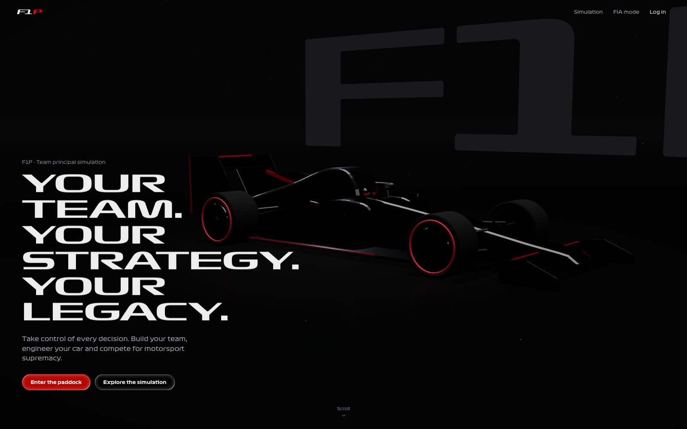

# F1P — Team Principal Simulation

**Run a motorsport team across a full 24-race season: drivers, car development, race weekends, a live pit wall, finances — or switch sides and govern the sport as the FIA.**

[](https://f1principalsim-orpin.vercel.app/)


[Live demo](https://f1principalsim-orpin.vercel.app/) · [Screenshots](#screenshots) · [Features](#features) · [Getting started](#getting-started) · [Deploy](#deploying-to-vercel)

</div>

---

## Live demo

**[https://f1principalsim-orpin.vercel.app](https://f1principalsim-orpin.vercel.app/)**

Click **Enter the paddock**, then **Play offline (local save)** to start a career without an account. Saves are kept in your browser. Sign in with an account to save to the cloud instead.

---

## Screenshots

### Live pit wall
Every car on the real circuit layout, a broadcast-style timing tower, battles within a second, the race feed, and the pit wall with driver instructions and the race engineer's calls.

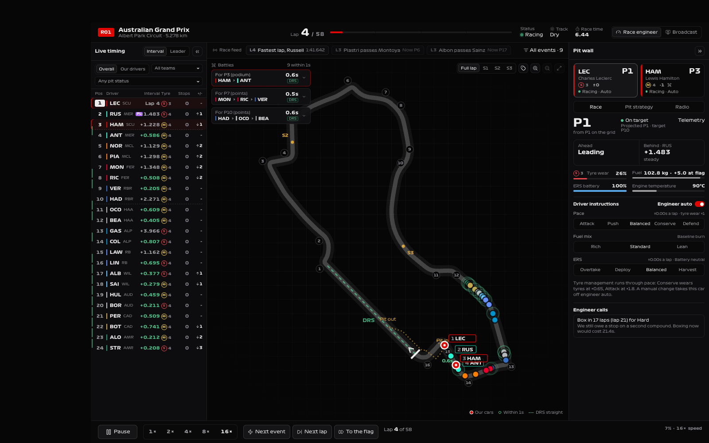

<table>
<tr>
<td width="50%">

**Pit strategy tab**<br/>
Stint timeline, tyre life, pit window, rejoin estimate and the strategy model's ranking of every pit option.

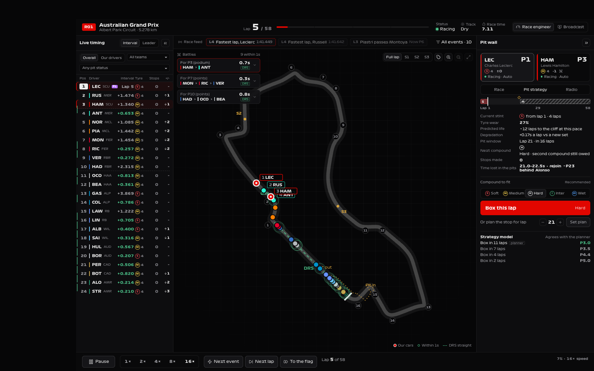
</td>
<td width="50%">

**Race weekend**<br/>
Car setup against the model's targets, the circuit map, and a planned race strategy for both drivers.

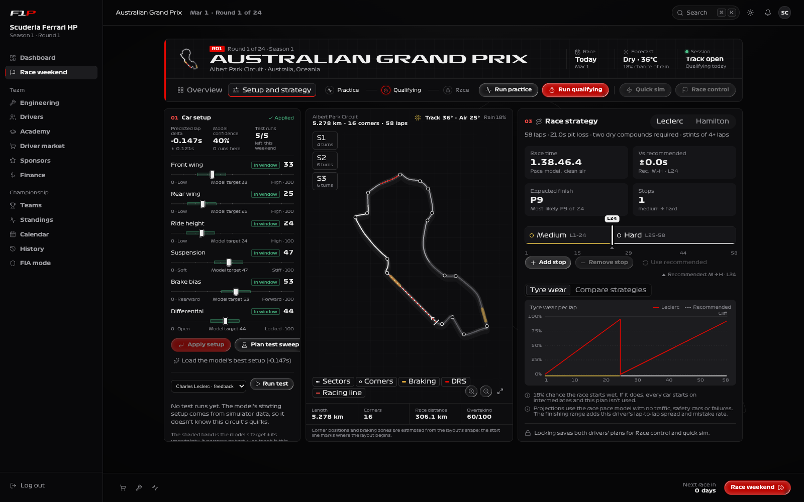
</td>
</tr>
<tr>
<td>

**Team dashboard**<br/>
Next race, forecast and objective, constructors' fight, budget and car performance at a glance.

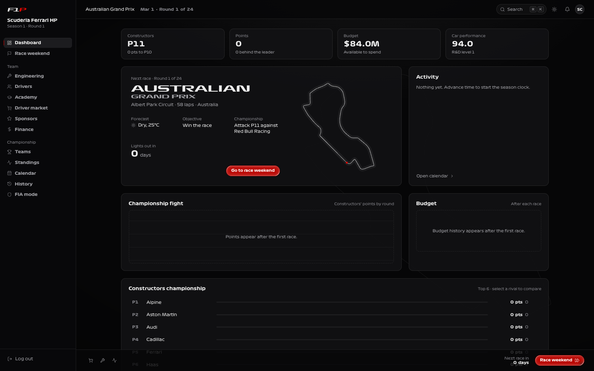
</td>
<td>

**Engineering**<br/>
An interactive 3D garage: pick a part to see what it does, how it rates and what the factory can bring next.

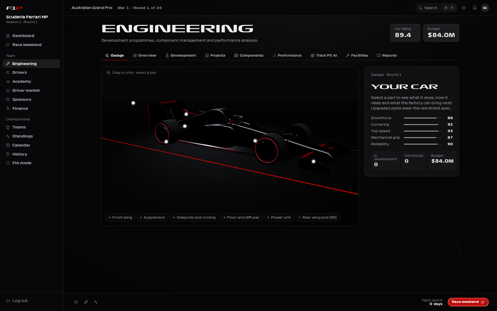
</td>
</tr>
<tr>
<td>

**Drivers**<br/>
Ratings, potential, attributes compared with the teammate, contract terms and morale.

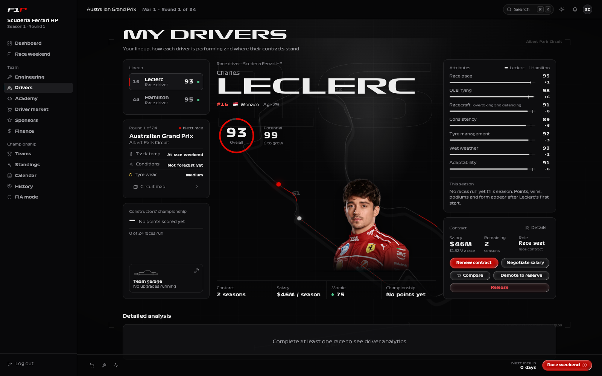
</td>
<td>

**Standings**<br/>
Drivers' and constructors' championships, podium, gaps, progression charts and team momentum.

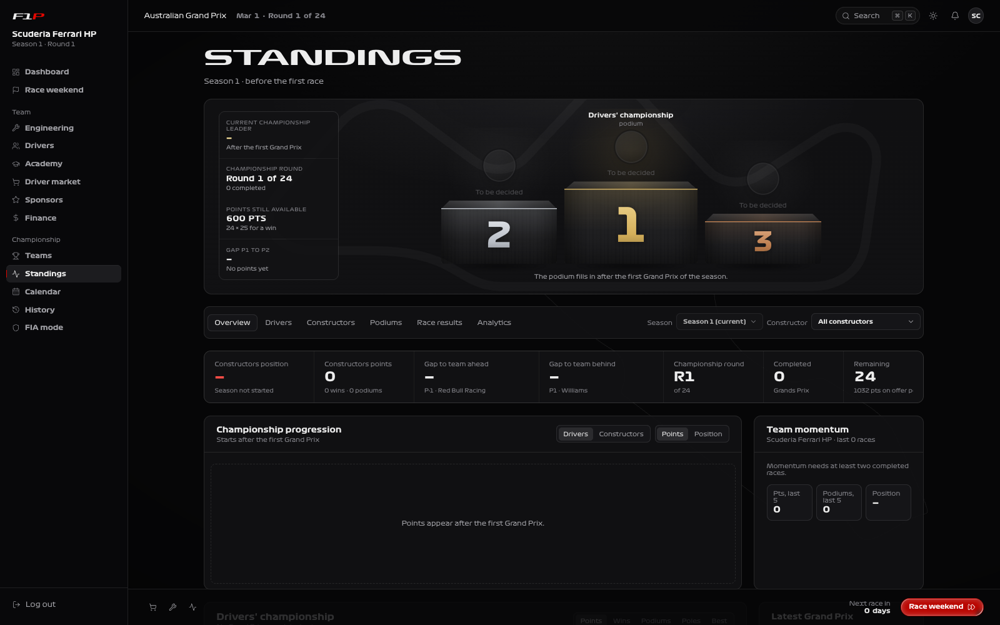
</td>
</tr>
<tr>
<td>

**Finance**<br/>
Cash flow, income and expenses, budget allocation, senior staff and board confidence.

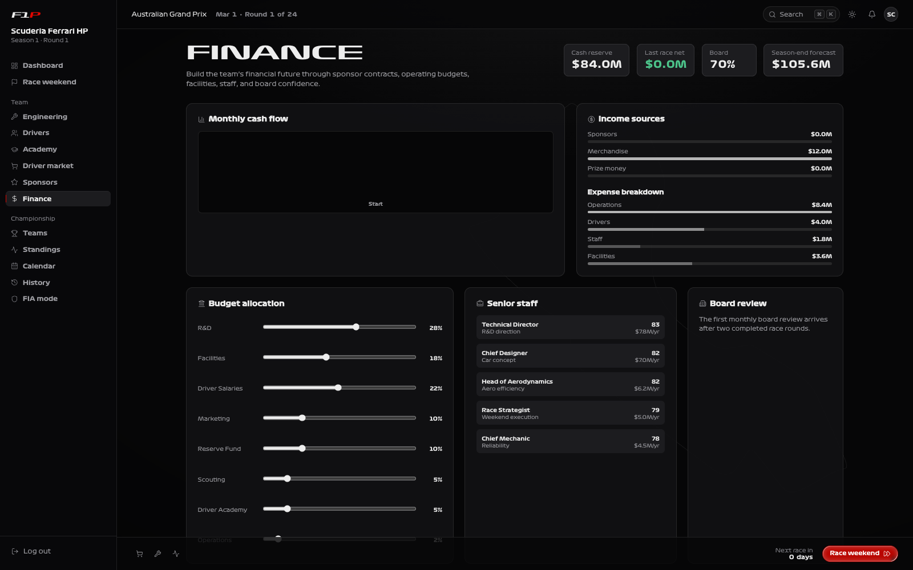
</td>
<td>

**Academy**<br/>
Scout, sign and develop junior drivers from karting to an F1 seat.

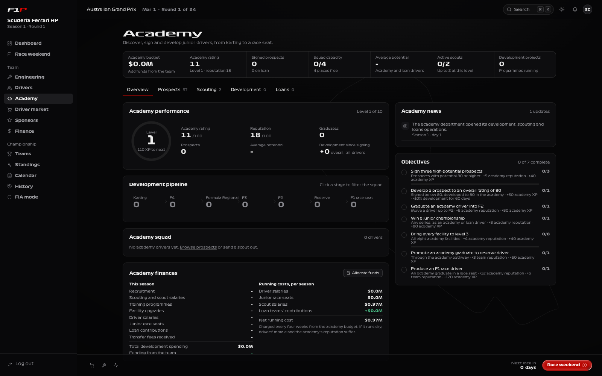
</td>
</tr>
<tr>
<td>

**FIA mode**<br/>
Play as the governing body: build the calendar, license circuits, set the rules and settle decisions.

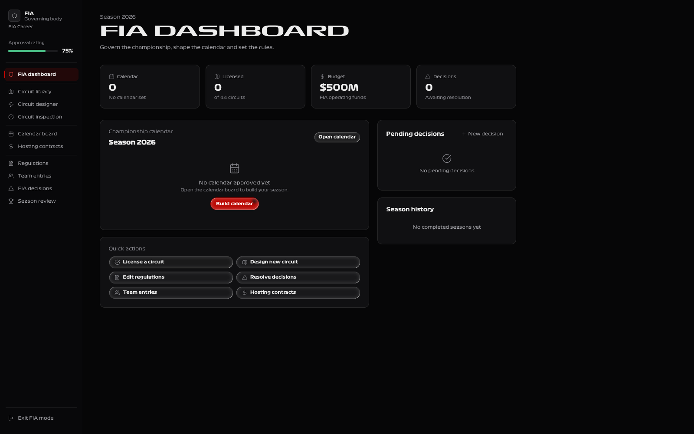
</td>
<td>

**Circuit library**<br/>
44 circuits with length, corners, overtaking difficulty, hosting fees and characteristics.

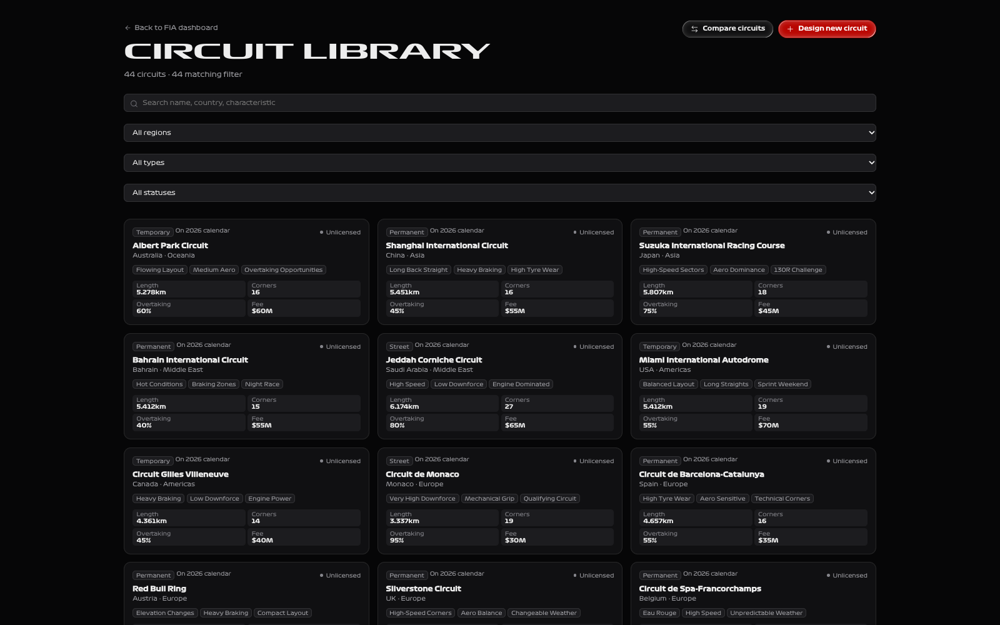
</td>
</tr>
</table>

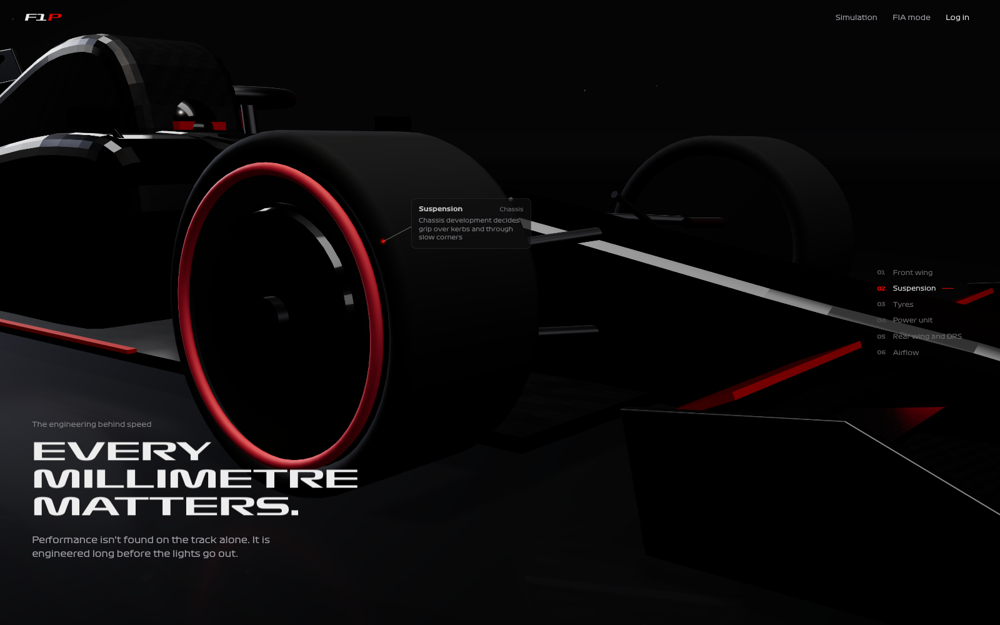

---

## Features

### Live pit wall (Race Control)
Everything on this screen reads the live race engine (`game/LiveRaceEngine.js`); your commands go through the engine's own pit, pace, fuel and ERS calls.

- **Circuit map** (`components/race/LiveCircuit.tsx`) — the real layout with every car in team colours, sector markers, DRS straight, corner numbers and pit lane. Hover for position, speed and tyres; click for telemetry; zoom, pan or focus a sector.
- **Timing tower** (`components/race/RaceParts.tsx`) — interval or gap to leader, compound and age, stops, places gained or lost. Filter by our drivers, constructor or pit status.
- **Pit wall** (`components/race/PitWall.tsx`)
  - *Race:* position against projected finish, gaps ahead and behind with trend, tyre wear, fuel margin, ERS and engine temperature.
  - *Driver instructions:* pace (Attack, Push, Balanced, Conserve, Defend), fuel mix (Rich, Standard, Lean) and ERS (Overtake, Deploy, Balanced, Harvest), each showing its effect.
  - *Pit strategy:* stint timeline, predicted tyre life, pit window, recommended compound and rejoin estimate. Box this lap, stay out, or plan a stop for a later lap.
  - *Radio:* driver and engineer messages.
- **Battles** (`components/race/BattleBoard.tsx`) — cars within a second, with gap trend, DRS range and tyre age difference.
- **Telemetry** (`components/race/TelemetryPanel.tsx`) — lap times, tyres, fuel, ERS and per-lap charts against the teammate.
- **Playback** — pause, 1× to 16×, next event, next lap, skip to the flag. Space pauses; keys 1–5 set the speed.
- **Broadcast mode** — a larger map and tower with banners for overtakes, fastest laps and retirements.

### Strategy model, race engineer and setup network
- **Pit-strategy model** (`game/strategy/`, `scripts/train-strategy-model.mjs`) predicts the finishing position for each pit option (box now, in 2/4/7/11 laps, or no stop) in about 55 µs per decision.
  - *Teacher:* a seeded Monte Carlo rollout simulator on the shared pace model, with traffic, dirty air, overtaking and rivals' own stops. A rollout decision takes ~113 ms, too slow to run live for every option, so the network learns to imitate it.
  - *Architecture:* a value ensemble (race state → places gained or lost) plus an advantage ensemble (state + option → how much better this option is), both 3-member MLPs in plain JS. The advantage net also sees the time-only planner's cost, so it learns a correction on top of the physics rather than relearning tyre maths. Ensemble spread is shown in-game as uncertainty.
  - *Data:* 6,000 race states (32k state–option samples) on 19 circuits, each option labelled with 24 rollouts using common random numbers.
  - *Offline evaluation* on 5 held-out circuits (Suzuka, Hungaroring, Singapore, Interlagos, Lusail) against an oracle with 96 rollouts per option. Regret is the positions a pick loses against the best option:

    | Decision rule | Mean regret (positions) |
    |---|---|
    | **Strategy model** | **0.174** |
    | Race engineer's time-only planner | 0.208 |
    | Always box now | 1.446 |
    | Random option | 1.456 |

  - *End-to-end evaluation* (`npm run eval:strategy`): 200 paired races in the live engine, with safety cars, VSCs and archetype-based rival strategies. The model's pit calls finished **0.63 places better per car** than the planner (SE 0.11, P12.30 vs P12.93), ahead in 114 races and behind in 56.
- **Race engineer** (`game/RaceEngineer.js`) — a rule-based strategist on the shared pace model (`game/paceModel.js`). Each tick it computes gaps and closing rates, laps to the tyre cliff, the best pit plan and the rejoin position; flags undercut and overcut chances; and can run the car on auto.
- **Forecast-driven objectives** (`utils/raceForecast.js`, `utils/raceObjectives.js`) — each Grand Prix is simulated 300 times from every car's pace on that circuit, rain odds, overtaking difficulty, tyre wear and reliability. Targets are pitched from those odds, and each explanation cites the numbers behind it.
- **Setup network** (`game/setup/`, `scripts/train-setup-model.mjs`) — a 3-member MLP ensemble (19→24→16→1) trained on 24,000 generated samples. On 8 held-out circuits (MAE 0.0245) it cuts setup loss from 0.180 to 0.094 before practice and to 0.033 after practice runs refine it.

### Race weekends
- **Practice** (`game/practice.js`) — test runs to dial in balance, tyre wear and grip.
- **Qualifying** (`game/qualifying.js`) — Q1 → Q2 → Q3 knockout, on the same pace model as the race (low fuel, fresh softs, the driver's one-lap skill).
- **Sprints** — a third of the distance from the qualifying grid, no mandatory stop, points for the top 8.
- **One rulebook, two engines** (`game/raceEvents.js`) — the quick sim (`game/raceSimulator.js`) and the live pit wall share the same pace model and events:
  - Safety cars and VSCs bunch the field and halve the cost of a stop.
  - Weather is decided once per weekend; qualifying conditions are the race's conditions.
  - Two dry compounds in a dry race or disqualification; a car that completes 90% is classified.
  - Every session runs from a stored seed, so the same seed and inputs replay the same race.
- **Post-race report** (`components/ui/DetailedRaceReport.tsx`) — classification, points, penalties and earnings.

### Car development
- **Four systems** (`screens/engineering.tsx`, `game/development.js`) — aerodynamics, power unit, chassis and reliability.
- **R&D projects** (`data/devProjects.js`) — commission upgrades, assign staff and track delivery.
- **Aero testing restrictions** — a sliding scale giving more wind tunnel and CFD time to teams further down.
- **Circuit suitability** (`utils/circuitSuitability.js`) — car performance against seven circuit demands: power, aero, mechanical grip, tyre degradation, braking, cooling and wet weather.

### Drivers, academy and market
- Ten driver attributes (pace, qualifying, racecraft, tyre management, wet weather, consistency, adaptability, feedback, mentality, media) plus hidden traits.
- **Academy** (`screens/academy.tsx`, `game/academy.js`) — scout prospects across five regions, set training programmes, loan drivers out and promote them to the race team.
- **Transfer market** (`screens/market.tsx`, `screens/myDrivers.tsx`) — multi-year contracts, release clauses, morale and scouting.

### Finance and sponsors
- **Finance** (`screens/finance.tsx`) — cash flow, cost cap, budget allocation, senior staff and board reviews.
- **Sponsors** (`data/sponsors.js`, `screens/sponsors.tsx`) — title sponsors, technical partners and media partners, each with their own terms.
- Prize money paid out from the constructors' standings.

### FIA mode
- **Dashboard** (`fia/FIADashboard.tsx`) — calendar, licensed circuits, budget and pending decisions.
- **Regulations** (`fia/screens/FIARegulations.tsx`) — cost cap ($80M–$250M), minimum weight (750–900 kg), sprint count and points tables.
- **Circuit designer** (`fia/screens/FIACircuitDesigner.tsx`) — draw a track, set pit entry and exit, and validate it.
- **Circuit library** (`fia/circuitLibrary.js`) — 44 circuits with demand ratings, hosting fees and characteristics.
- **Stewards and licensing** (`fia/screens/FIADecisions.tsx`, `fia/screens/FIALicensing.tsx`) — penalties, grid drops and super licence points.

### History and replay
- **Race replay** (`screens/RaceReplay.tsx`) — scrub through finished races on the track map.
- **History** (`screens/history.tsx`) — past results, podiums, driver form and head-to-heads.
- **Standings** (`screens/leaderboard.tsx`) — both championships with progression charts.

---

## Tech stack

| Layer | Technology |
|---|---|
| UI | React 19, TypeScript |
| Build | Vite 8 |
| Styling | Tailwind CSS v4, PostCSS |
| Components | Radix UI primitives, Lucide icons |
| 3D | Three.js, React Three Fiber, Drei |
| Motion | Framer Motion |
| Charts | Chart.js, react-chartjs-2 |
| Backend | Supabase (Postgres, Row Level Security, Auth) |
| Data | OpenF1 API for driver and team data |
| Simulation | Shared pace model, Monte Carlo rollouts, from-scratch MLP ensembles |
| Hosting | Vercel |

---

## Project structure

```
f1manager/
├── assets/              # Fonts, logo, README screenshots
├── components/          # Shared UI, hub layout, race control panels
│   ├── race/            # Circuit map, timing tower, pit wall, battles, telemetry
│   └── ui/              # Primitives, race report, briefing, objective cards
├── data/                # Calendar, drivers, teams, sponsors, track layouts
├── fia/                 # FIA mode: dashboard, regulations, circuits, decisions
├── game/                # Simulation: race engines, pace model, engineer, strategy, setup
├── lib/                 # Supabase client and API helpers
├── screens/             # Full-page screens (dashboard, weekend, engineering, …)
├── scripts/             # Model training and evaluation
├── strategy_ml/         # Real-world data fetchers (OpenF1, Jolpica, FastF1)
├── supabase/            # Schema and migrations
├── utils/               # Forecasts, objectives, finance, suitability, tests
├── app.js               # Entry point
└── vercel.json          # SPA rewrites
```

---

## Getting started

**Requirements:** Node.js 22 or newer, npm.

```bash
git clone https://github.com/Thatblazerguy/f1principalsim.git
cd f1principalsim
npm install
cp .env.example .env   # optional; without it the game runs with local saves
npm run dev
```

The dev server runs at `http://localhost:5173`. In development you can open a screen directly with a demo team, e.g. `?screen=pitwall`, `?screen=weekend`, `?screen=engineering` or `?screen=fia`.

| Command | What it does |
|---|---|
| `npm run dev` | Start the dev server |
| `npm run build` | Production build into `dist/` |
| `npm run preview` | Serve the production build |
| `npm run check` | Lint, typecheck and tests |
| `npm run train:setup` | Retrain the setup network |
| `npm run train:strategy` | Retrain the pit-strategy model |
| `npm run eval:strategy` | Run the end-to-end strategy evaluation |

### Environment variables

| Variable | Required | Description |
|---|---|---|
| `VITE_SUPABASE_URL` | No | Supabase project URL |
| `VITE_SUPABASE_ANON_KEY` | No | Supabase public anon key |

Without Supabase credentials the game runs entirely in the browser with local saves.

### Supabase (optional)
1. In your Supabase project, open the **SQL Editor**.
2. Run `supabase/schema.sql` to create the tables and RLS policies.
3. Run `supabase/save_patch.sql` for later schema changes.

Tables: `profiles`, `user_game_state`, `race_results`, `teams` and `drivers`.

---

## Deploying to Vercel

[](https://vercel.com/new/clone?repository-url=https%3A%2F%2Fgithub.com%2FThatblazerguy%2Ff1principalsim&env=VITE_SUPABASE_URL,VITE_SUPABASE_ANON_KEY&envDescription=Supabase%20API%20Credentials&project-name=f1principalsim)

Or import the repository in the Vercel dashboard with these settings:

| Setting | Value |
|---|---|
| Framework preset | Vite |
| Build command | `npm run build` |
| Output directory | `dist` |
| Install command | `npm install` |

`vercel.json` rewrites every path to `index.html` so client-side navigation survives a refresh. From the CLI: `npx vercel --prod`.

---

## Troubleshooting

| Problem | Fix |
|---|---|
| Demo-mode notice on load | Expected without Supabase. Add `VITE_SUPABASE_URL` and `VITE_SUPABASE_ANON_KEY` to enable cloud saves. |
| 404 on refresh in production | Make sure `vercel.json` is in the project root. |
| Styles missing after build | Run `npm run build` locally and check the Tailwind PostCSS step. |
| Live race feels slow | Close the browser dev tools; the race runs on `requestAnimationFrame`. |

---

## License

ISC. F1P is an independent fan-made game and is not affiliated with Formula 1, the FIA or any team. Driver and circuit data comes from the [OpenF1 API](https://openf1.org/).

Made by [Thatblazerguy](https://github.com/Thatblazerguy).
